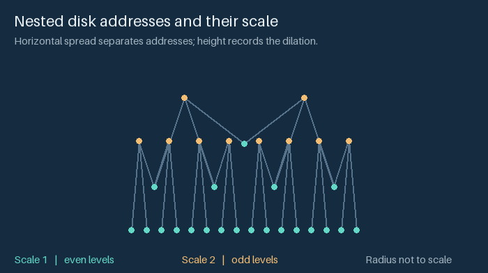

# Cantor exceptions for homeomorphisms preserving regular C¹ curves

  

Can a surface homeomorphism taking regular C¹ circles to regular C¹ circles in both directions fail to be differentiable at uncountably many points? Can those points have positive area? **Yes to uncountability. No to positive area.** One locally bilipschitz example has a Cantor set as its exact exceptional set. For every forward circle-preserving homeomorphism, the exceptional set has area zero. [Booth's Question 1.5](https://arxiv.org/pdf/2410.21460v4#page=3) · [Catalog entry Q1718](https://github.com/10m-u/open-problems-catalog/blob/main/problems/mathematics/topology-part-1.md#q1718)

[Read the paper (PDF)](paper/manuscript.pdf) · [LaTeX source](paper/manuscript.tex) · [Complete proof](proof/PROBLEM_AND_PROOF.md) · [Citation](CITATION.cff)

## Explore the proof in 3D

[Download the offline explorer](https://raw.githubusercontent.com/DannyExperiments/cantor-exceptions-for-curve-preserving-homeomorphisms/v1.0.0/visualization/construction-explorer.zip). Extract it and open **index.html**. Rotate the diagram and follow a single address to any displayed depth. Vertical height records the dilation on each core. The core radii in the actual construction shrink much faster than the schematic spacing. [Figure guide](visualization/README.md)

## One address, two scales

At any point of the limiting Cantor set, take a vertical step equal to half the radius of its level-*n* core. At depth 3 the image difference quotient lies within 1/2048 of twice the vertical unit vector. At depth 4 it lies within 1/4096 of the unit vector. The same alternation continues down every binary address, with errors tending to zero. This destroys the vertical derivative. The angle between a source secant and its image nevertheless tends uniformly to zero on deep cores, giving a continuous tangent to each image curve.

## Why positive area is impossible

A coordinate segment sits in a regular test circle. On sufficiently short intervals its image has a C¹ graph parametrization, traversed with a strictly monotone coordinate. The scalar coordinate has a finite derivative almost everywhere. Fubini gives finite partial derivatives almost everywhere in the chart, and Gehring–Lehto upgrades them to total differentiability for the open planar map.

The rational replay checks the geometric inequalities at 16 finite levels. The manuscript proves the limiting statements. [Replay instructions](REPRODUCIBILITY.md) · [Scope](CLAIM_SCOPE_AND_LIMITATIONS.md) · [Literature review](audits/public_safe_reports/LITERATURE_AUDIT.md) · [AI disclosure](AI_DISCLOSURE.md)
